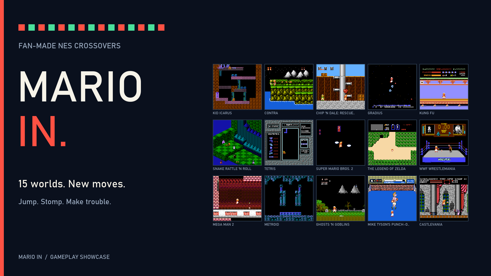

# Mario In

Native NES ROM hacks that put SMB1 Mario and Luigi into other games, with the
host mechanics each game needs. Sources, build tools, art inputs, and regression
fixtures are organized by game. Current IPS patches are in [release/](release/).

[](media/Mario%20In%20-%20Trailer.mp4)

[Watch the 92-second gameplay trailer](media/Mario%20In%20-%20Trailer.mp4) |
[Trailer notes and recording tools](media/)

| Game | Source and controls |
| --- | --- |
| Castlevania | [castlevania](castlevania/) |
| Kid Icarus | [kidicarus](kidicarus/) |
| Contra | [contra](contra/) |
| Chip 'n Dale: Rescue Rangers | [rangers](rangers/) |
| Gradius | [gradius](gradius/) |
| Kung Fu | [kungfu](kungfu/) |
| Snake Rattle 'n Roll | [snake](snake/) |
| Tetris | [tetris](tetris/) |
| Super Mario Bros. 2 USA | [smb2](smb2/) |
| The Legend of Zelda | [zelda](zelda/) |
| WWF WrestleMania | [wwf](wwf/) |
| Mega Man 2 | [megaman2](megaman2/) |
| Metroid | [metroid](metroid/) |
| Ghosts 'n Goblins | [ghosts](ghosts/) |
| Mike Tyson's Punch-Out!! | [punchout](punchout/) |

## Build

The existing toolchains target Windows. Install Python, Git, and the packages
in `requirements.txt`. Put your matching original game ROMs and
`Super Mario Bros. (World).nes` in `C:\nes`; exact required SHA-256 hashes are
in [release/catalog.json](release/catalog.json). ROM images are local build
inputs and generated outputs, and are excluded from this repository.

```powershell
git clone --recurse-submodules https://github.com/kandowontu2/Mario-In.git
cd Mario-In
python -m pip install -r requirements.txt
python tools/bootstrap.py
python tools/build_port.py ghosts
# Or: python tools/build_port.py all
```

Each output goes into `<game>/dist/`. Building does not install over the ROMs
in `C:\nes`. Individual project READMEs document their verification and optional
installation commands. Kid Icarus's original commands run from `kidicarus/`.
The shared source and helpers remain under `src/` and `tools/`.

The vendored disassemblies and SMB1 reference are pinned Git submodules;
[dependencies.json](dependencies.json) records their revisions. Bootstrap also
fetches a SHA-256-checked WLA-DX 10.7 Windows toolchain for Metroid's reference.
Mesen 2 is needed for emulator tests; the existing runners expect
`C:/mesen2/Mesen.exe`.

## Verification and credits

The release catalog records the exact base, patch, and output hashes. Existing
receipts accompany each patch. Source-package checks separately compare clean
rebuilds with those released outputs. Fixture coverage and remaining campaign
and hardware limits are documented in the game READMEs and receipts.

[PHYSICS-AUDIT.txt](PHYSICS-AUDIT.txt) and
[PHYSICS-FIXES.txt](PHYSICS-FIXES.txt) document the SMB1 movement comparisons
and intentional adaptations. Directional art provenance is in
[assets/DIRECTIONAL-SOURCE.md](assets/DIRECTIONAL-SOURCE.md); Contra's supplied
art inputs and credits are in its folder. Retain upstream notices and licenses.
No blanket license is asserted over Nintendo/game artwork, supplied sprite
sheets, or third-party disassemblies.
