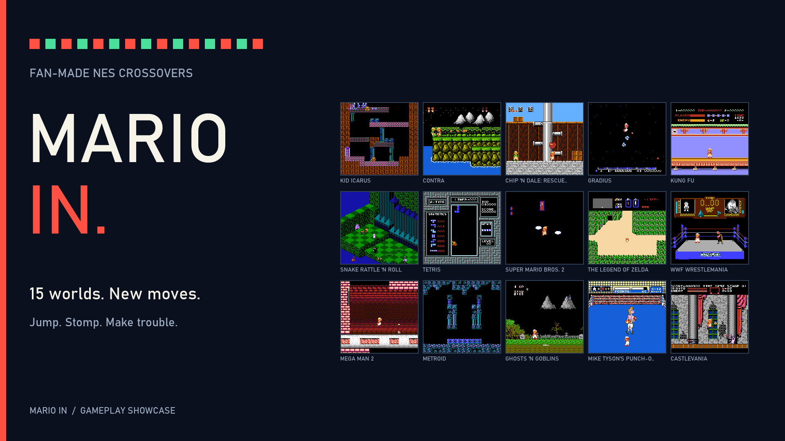

# Mario In trailer

[Watch/download the trailer](Mario%20In%20-%20Trailer.mp4)

- 1 minute 32 seconds, 1920 x 1080, 60 fps.
- All 15 current ports, including Castlevania.
- Native game video and audio, with captions explaining Mario's mechanics.
- Embedded game chapters; edit timings are in `trailer-edit.json`.

Sprite sheet: **metalwario64** and **superphanto**.  
Testing: **cecilou**, **jroweboy** and **fanatik**.
These credits also appear on the trailer's end card.



The footage was captured directly from the current ROM hashes in the release
catalog. It uses the included emulator fixtures; some encounters and power
states are staged to show a mechanic. This is an edited showcase, not a claim
of continuous unassisted play. The short title/end jingle is generated by the
render script; gameplay audio comes from each game.

To recreate it after building the ports, install FFmpeg/ffprobe and a 64-bit
GCC compiler alongside the game-test prerequisites, then run from the repo root:

```powershell
python tools/trailer/record_all.py
python tools/trailer/render.py
python tools/trailer/verify.py
```

The recording bridge calls Mesen's public AVI recording exports. It does not
alter emulated memory or inputs. Fixture scripts provide the controller/state
setup. Generated captures and intermediate video remain under ignored `build/`.
The render uses the Windows Bahnschrift font. Verification checks all 15 source
ROM and fixture hashes, complete video decoding, frame count, resolution,
chapters, non-silent audio, and matching audio/video duration.

The Zelda and WrestleMania clips were recaptured after repairing asymmetric item-lift art and deformable rope pattern ownership. Their capture fixtures now audit the relevant displayed graphics, including the final Zelda pickup and every WrestleMania rope frame.
